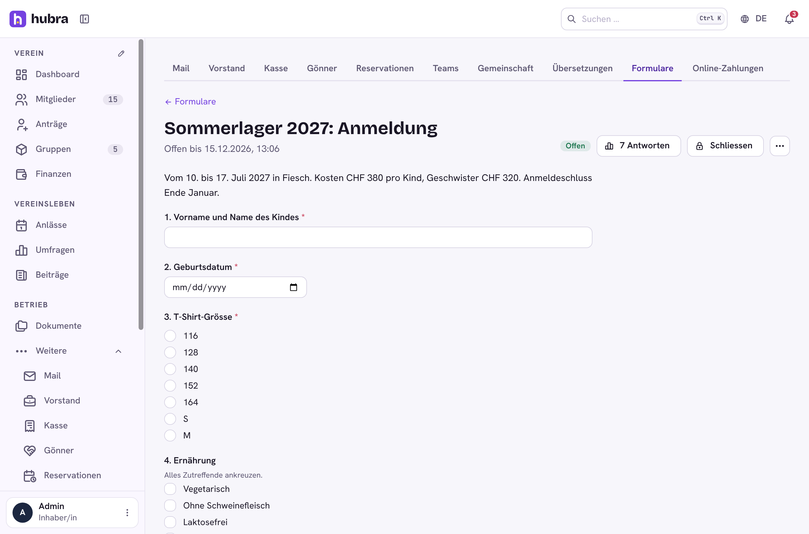
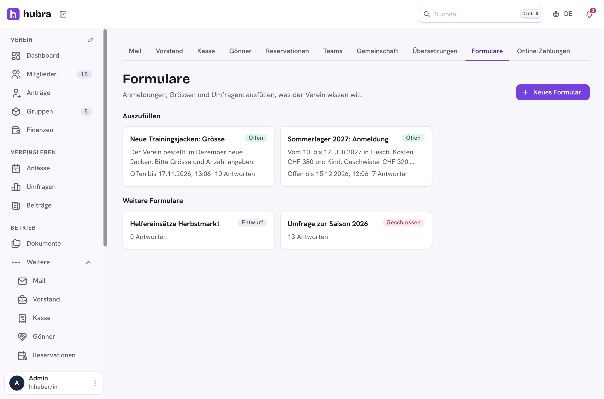
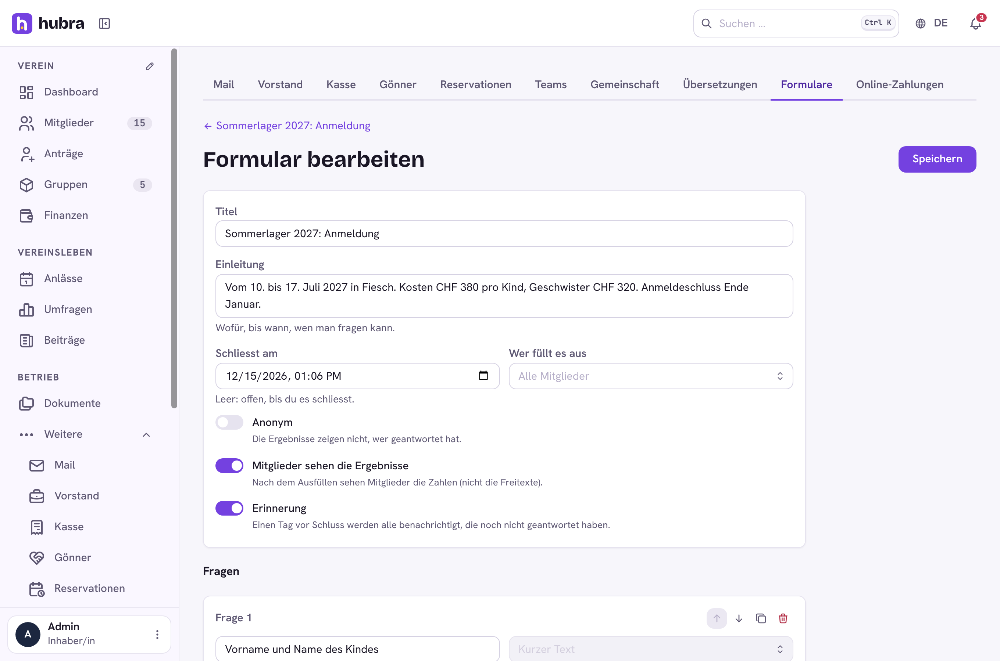
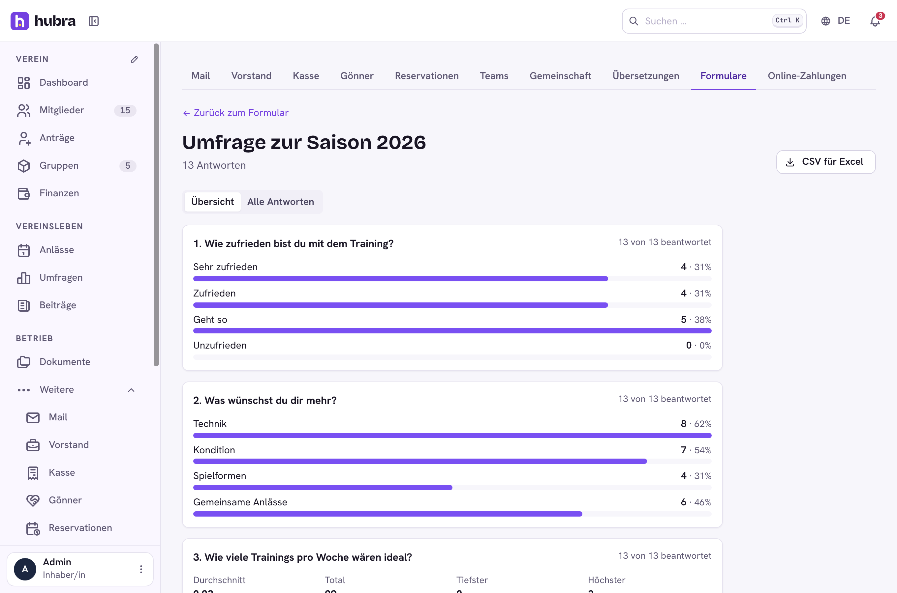
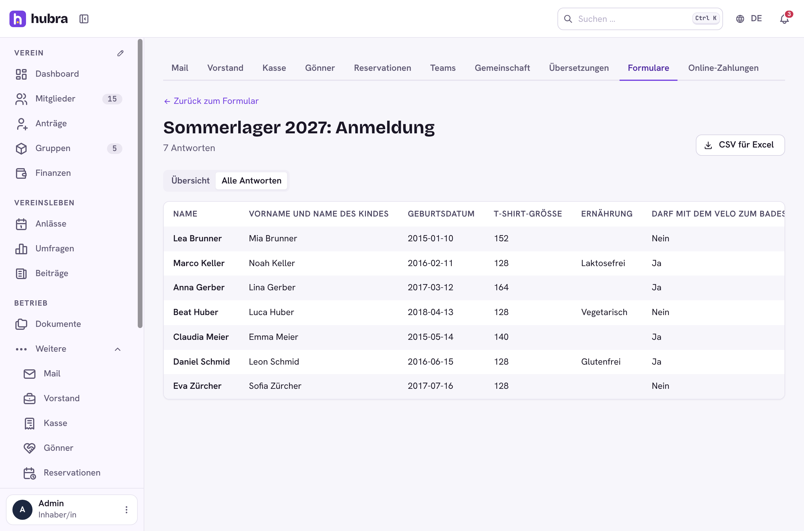

# Forms

[](https://github.com/hubra-app/hubra-plugin-forms/actions/workflows/release.yml?query=branch%3Amain) [](https://github.com/hubra-app/hubra-plugin-forms/releases/latest) [](LICENSE)

A plugin for [Hubra](https://hubra.club). Forms and surveys: the board builds a form (camp sign-up, kit sizes, a satisfaction survey), members fill it in, and the answers come back as a summary, a table or a CSV.

**Version** 1.0.0 · **Works with** Hubra >=0.2,<1 · **Plugin id** `forms` · **Needs** the members module



## What it does

| Part | |
| --- | --- |
| Building | Questions of seven kinds: short text, long text, number, date, one choice, several choices, yes/no. Each can be required and have a help text. A form is for every member or for one group, and can close at a set time. Forms start as drafts that only the board sees; "copy" starts next year's form from this year's. |
| Opening | Opening a form can notify its members. A day before it closes, those who haven't answered get a reminder (if the form asks for one). |
| Answering | Each member answers once and can change or withdraw the answer while the form is open. Anonymous forms never show who answered, not even to the board (the member is still stored so nobody answers twice). |
| Results | Counts and percentages per choice, average, total, lowest and highest for numbers, and the text answers. The board also sees every answer as a table, who hasn't answered yet, and downloads a CSV for Excel (cells that look like formulas are escaped). With "members see the results" on, members see the counts after answering, but not the free text. |

Permission: `forms.forms.update` (build forms, see every answer). Every
member sees the open forms meant for them.

| | |
| --- | --- |
|  |  |
|  |  |

## Install

Platform admins install it from the plugin catalogue in the manager portal
(official Marketplace, <https://plugins.hubra.club/index.json>, signed with
the Hubra project key). Clubs then switch it on under Einstellungen → Module
& Plugins.

## Develop

Clone this repository into `plugins/forms` of a Hubra checkout. Its tests
then run with Hubra's (`cd app/backend && pytest ../../plugins/forms`), and
`npm run build:plugin` in `app/frontend` builds its frontend. The workflow
does the same against Hubra's `main` on every push and pull request.

## Releasing

Bump `version` in `plugin.yaml`, add a `## <version>` section to
`CHANGELOG.md` and merge. Then tag the merged commit on main and push the tag:

```sh
git switch main && git pull
git tag v<version> && git push origin v<version>
```

The workflow tests the plugin and builds its frontend, the `plugin-signing`
job signs it after your approval, and only then is the GitHub release
`v<version>` published, with `forms-<version>.zip` and its `.sha256` attached.
Files listed in `.releaseignore` stay out of the zip. Releases are immutable,
so a published version never changes: fix a bad one with a new version.

Source: <https://github.com/hubra-app/hubra-plugin-forms>
